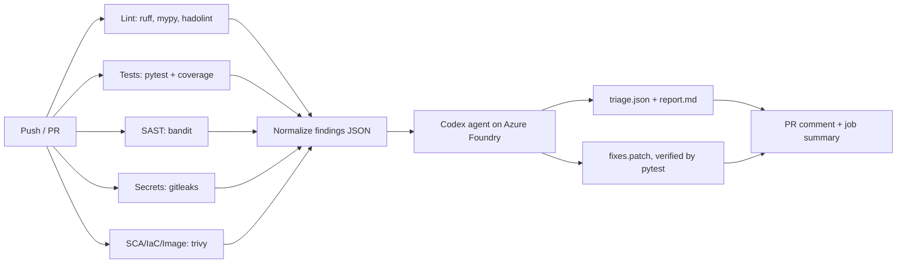

# agentic-triage

A demo of a **DevSecOps pipeline with an agentic triage step**. Classic scanners
produce findings. A Codex agent, backed by a model on **Azure AI Foundry**, then
validates them against the real code, drops false positives, prioritizes the rest and
proposes tested fixes as a patch.


## What's in the app

A small Flask service (`app/main.py`) with deliberately planted issues.  

## Setup

1. Create a model deployment in Azure AI Foundry. A Codex-capable model works,
   for example `gpt-5-codex`. Note the **deployment name**.
2. In the repo go to *Settings → Secrets and variables → Actions*:
   - Secret `AZURE_OPENAI_ENDPOINT`: e.g. `https://my-resource.openai.azure.com`
   - Secret `AZURE_OPENAI_API_KEY`
   - Variable `AZURE_OPENAI_DEPLOYMENT`: your deployment name
   - Optional variables: `CODEX_VERSION` (pin it!) and `CODEX_SANDBOX`
     (`workspace-write` by default)
3. Push to `main` or open a PR. Results appear in:
   - the job summary, which has the raw counts plus the triage report
   - a sticky PR comment
   - the `triage-results` artifact (`triage.json`, `report.md`, `fixes.patch`)

Apply the proposed fixes locally:
```bash
gh run download <run-id> -n triage-results -D out
git apply out/triage/fixes.patch
```

## Design notes and guardrails

- **Scanners never block, but lint and tests do.** Security tools use `--exit-code 0`
  so the agent always sees the full picture. The `gate` job fails on lint or test failure.
- **Least privilege.** The agent job checks out with `persist-credentials: false`, and
  the agent never receives `GITHUB_TOKEN`. Only a later shell step posts the PR comment.
- **Sandboxed agent.** `codex exec --sandbox workspace-write` means no network and
  writes only inside the workspace. If the Linux sandbox is unavailable on your runner
  image, set `CODEX_SANDBOX=danger-full-access`. Do this only on ephemeral GitHub-hosted
  runners and with minimal secrets.
- **Prompt injection.** Findings and code are untrusted input. The prompt tells the agent
  to treat them as data, and the agent cannot push or reach the network. Still review the
  patch before applying it.
- **Fork PRs** get no secrets, so the agent step is skipped and raw findings are still published.
- **Human in the loop.** The agent proposes a patch and never commits.
- **Verification.** The pipeline runs `pytest` on the patched tree and reports the result.

## Extending

- Upload SARIF to GitHub Code Scanning (`github/codeql-action/upload-sarif`).
- Open an automatic fix PR from `fixes.patch` with `peter-evans/create-pull-request`.
- Add Semgrep, Checkov, SBOM generation (`trivy sbom`) or DAST (OWASP ZAP).
- Fail the gate on agent-confirmed `P0` findings by reading `triage/triage.json`.

## Local dev
```bash
make install && . .venv/bin/activate
make lint test sast
make docker
```